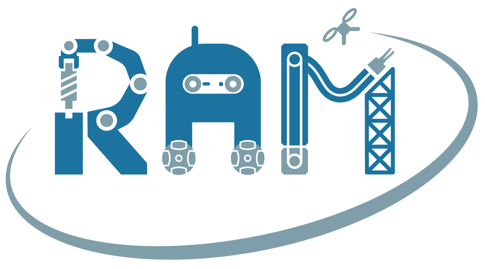

# trossen_widowx_driver_crospi Package

This package contains a driver for controlling the Trossen WidowX using crospi_core, based on template_driver_crospi package which uses ROS2 plugins.

## Installation

This driver requires the [interfaces package](https://github.com/Robotics-Research-Group-KUL/trossen_widowx_interfaces) and the [Trossen C++ driver](https://docs.trossenrobotics.com/trossen_arm/main/getting_started/software_setup.html) (`libtrossen_arm`). The Trossen C++ driver is a CMake package with a *package.xml*, so both can simply be cloned into your workspace and built with *colcon*:

```bash
cd <your_ws>/src
git clone https://github.com/Robotics-Research-Group-KUL/trossen_widowx_interfaces.git
git clone https://github.com/TrossenRobotics/trossen_arm.git
cd <your_ws>
colcon build --packages-up-to trossen_widowx_driver_crospi
```

Alternatively, install the Trossen C++ driver system-wide as described in its [documentation](https://docs.trossenrobotics.com/trossen_arm/main/getting_started/software_setup.html) (`cmake` + `make install`); CMake then finds it with `find_package(libtrossen_arm)`.

Note: Trossen officially supports the C++ driver on Ubuntu 20.04, 22.04 and 24.04 (it is distributed as a prebuilt static library).

## Troubleshooting

### `The major and minor versions of the driver and controller firmware must match`

When the driver starts, it prints both versions. For example:

```
[INFO] Driver version: 'v1.11.0'
[INFO] Controller firmware version: 'v1.9.1'
[CRITICAL] The major and minor versions of the driver and controller firmware must match.
...
terminate called after throwing an instance of 'trossen_arm::LogicError'
  what():  This TrossenArmDriver is not configured
```

The `libtrossen_arm` version on your PC must have the same **major.minor** as the firmware on the arm's controller (here `1.11` ≠ `1.9`). The patch number can differ, so driver `v1.9.3` works with firmware `v1.9.1`. There are two ways to fix it:

**Option A: update the controller firmware** to match your driver. Follow Trossen's [firmware upgrade guide](https://docs.trossenrobotics.com/trossen_arm/main/getting_started/firmware_upgrade.html). This changes the arm itself, so check with others who use the same arm first.

**Option B: downgrade `libtrossen_arm`** to match the firmware. Pick the newest tag that has the firmware's major.minor:

```bash
cd <your_ws>/src/trossen_arm
git fetch --tags
git tag -l 'v1.9*'          # list tags matching the firmware's major.minor
git checkout v1.9.3         # newest matching tag
cd <your_ws>
colcon build --packages-select libtrossen_arm trossen_widowx_driver_crospi --cmake-clean-cache
source install/setup.bash
```

You must rebuild `trossen_widowx_driver_crospi` as well, because `libtrossen_arm` is linked statically. This driver only uses API calls that exist from v1.9 onward, so no code changes are needed. To go back to the latest version after a firmware upgrade, run `git checkout main` in `trossen_arm` and rebuild both packages.

If `libtrossen_arm` is also installed in an underlay workspace or system-wide, make sure the copy you downgraded is the one CMake finds. Sourcing your workspace last does this when the downgraded copy is in your workspace.

## Documentation

For documentation and tutorials, checkout our [crospi website](https://crospi-website-907f83.pages.gitlab.kuleuven.be/).

## License and acknowledgements

Published under the [Apache-2.0 license](LICENSE).

## Authors
<p float="left">
<a href="https://www.kuleuven.be/english/kuleuven/">
    
</a>
<a href="https://www.mech.kuleuven.be/en/research/ram">
    
</a>
</p>

(c) 2025, KU Leuven, Department of Mechanical Engineering, ROB-Group:

- [Federico Ulloa Rios](https://www.kuleuven.be/wieiswie/en/person/00141400)
